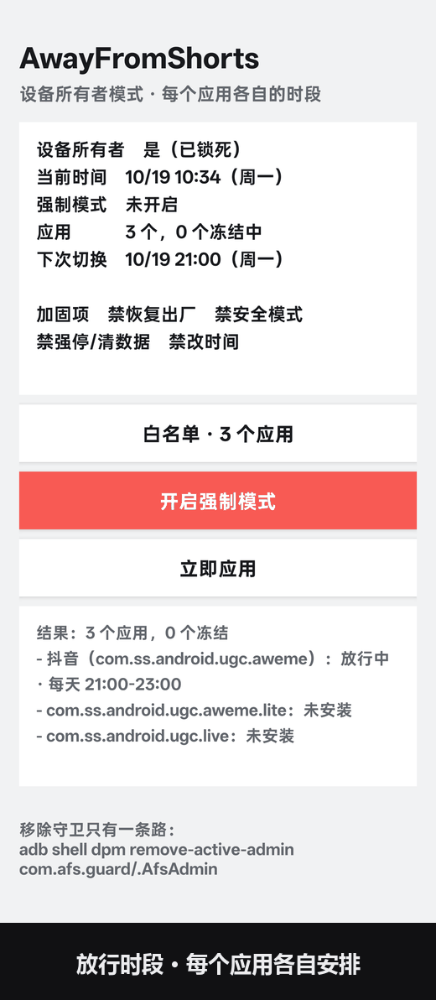
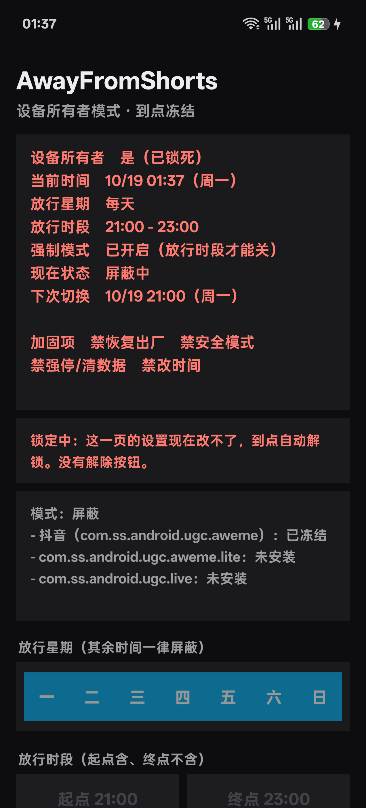
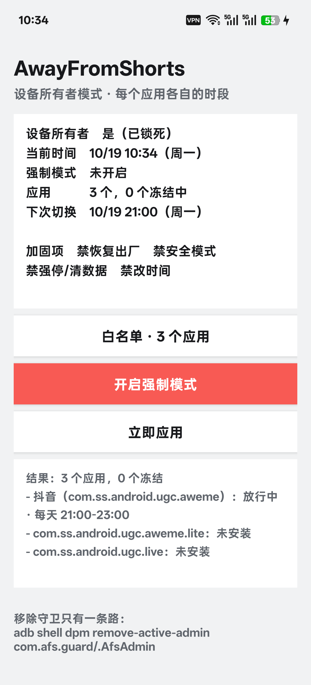
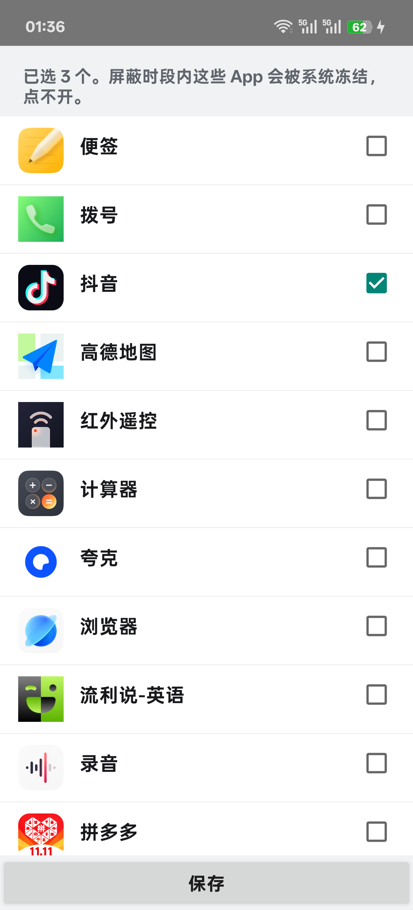

# AwayFromShorts

> A self-control tool for short-video addiction. Blocks at the OS level, not with a timer you can dismiss.

[](https://github.com/sdgfdii/AwayFromShorts/releases/latest)
[](LICENSE)

[中文说明](README.md) · [Download APK](https://github.com/sdgfdii/AwayFromShorts/releases/latest)

---

## Two halves, two platforms

| | Windows | Android |
| --- | --- | --- |
| What it does | Blocks short-video **websites** (hosts) and **programs** (process kill) on a weekly schedule | **Freezes the apps** at the OS level, so they cannot be opened at all |
| How strong | Medium — you're the admin of your own PC | **Hard lock**: factory reset is greyed out, force-stop and uninstall are blocked, safe mode and clock changes are disabled |
| Where | `src/` — PowerShell + a single-file local web panel, zero dependencies | `phone/dpc/` — Device Owner app, no Gradle needed |
| Requires | Windows 7/10/11 | Android 7.0+, and **one factory reset** |

There is also a lighter Android option in `phone/blocker/` (Accessibility Service, no reset needed, but you can turn it off yourself).

---

## Android: the hard-lock version



  

Left: blocked state — the whole UI goes dark, every control is disabled.
Middle: allowed state — light theme, settings editable.
Right: pick which apps to freeze.

The third frame of the GIF is what you see when you tap the frozen app: that dialog is
Android's own `ActionDisabledByAdminDialog`, not something the app draws — the app isn't
even running at that point.

### Why Device Owner

Android gives exactly one way to make an app truly unopenable: `DevicePolicyManager.setPackagesSuspended()`.
That API is only available to a **Device Owner** — a special app that owns the device's management policy.

Getting Device Owner requires a device with **no accounts and a single user**, then:

```bash
adb shell dpm set-device-owner com.afs.guard/.AfsAdmin
```

The catch: most phones fail this check because of a *second user* created by OEM "app cloning" /
"private space" / "work profile" features. Once created, these users usually cannot be removed —
a factory reset is the only reliable fix. Details in [COMPATIBILITY.md](phone/dpc/COMPATIBILITY.md).

### Install

```bash
# 1. Factory reset. In the setup wizard, DO NOT use "phone clone / data migration" —
#    it restores the clone profile and you'll be back to square one.

# 2. Enable USB debugging, plug in the cable.

# 3. Run:
git clone https://github.com/sdgfdii/AwayFromShorts.git
cd AwayFromShorts/phone/dpc
bash deploy.sh
```

`deploy.sh` checks every precondition first and tells you exactly what's wrong if it fails:

```
1/6 device connected?          → adb state, Android version
2/6 already deployed?          → if yes, just update the APK
3/6 only one user?             → lists what creates extra users on your ROM
4/6 no accounts?               → prints them (yes, an app account counts — Douyin registers one)
5/6 install APK                → push + pm install
6/6 set Device Owner           → verify
```

On first launch you get a **10-minute grace window** to configure weekdays, the allowed time window,
and which apps to freeze. After you press "Apply", settings lock until the next allowed window.

### Remove it

There is exactly one way out. That's the point.

```bash
cd phone/dpc && bash uninstall.sh
```

### What it configures

- **Allowed weekdays** (multi-select) and **allowed time window**, e.g. Mon–Fri 21:00–23:00
- Outside that window: selected apps are frozen, the UI is locked and turns dark
- **Forced mode**: a switch (no duration). While on, apps stay frozen even during the allowed window.
  It cannot be turned off during blocked hours — only inside the allowed window
- Hardening: `DISALLOW_FACTORY_RESET`, `DISALLOW_SAFE_BOOT`, `DISALLOW_APPS_CONTROL`,
  `DISALLOW_CONFIG_DATE_TIME`

### Test without a phone

```bash
cd phone/dpc && bash test/run.sh     # 38 assertions, pure Java, no device
```

Covers weekday masks, cross-midnight windows, exact flip points and forced-mode semantics.

---

## Windows

```powershell
irm https://raw.githubusercontent.com/sdgfdii/AwayFromShorts/main/install.ps1 | iex
```

hosts-level site blocking, process killing, browser-window closing, a local web panel at
`http://127.0.0.1:8737`, and a log of every time you overrode it. See the [Chinese README](README.md)
for details (the panel UI is Chinese-only).

---

## License

MIT. Do whatever you want with it.
